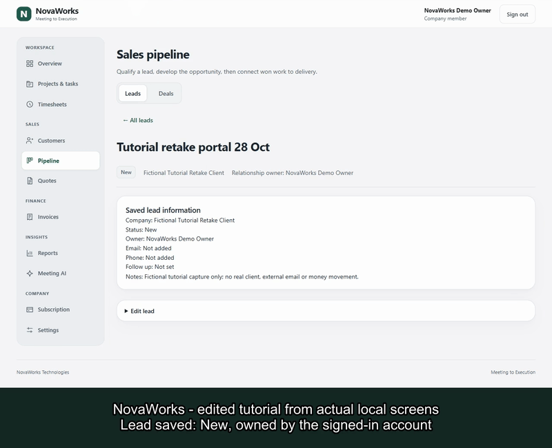
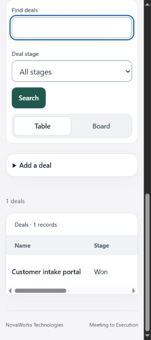
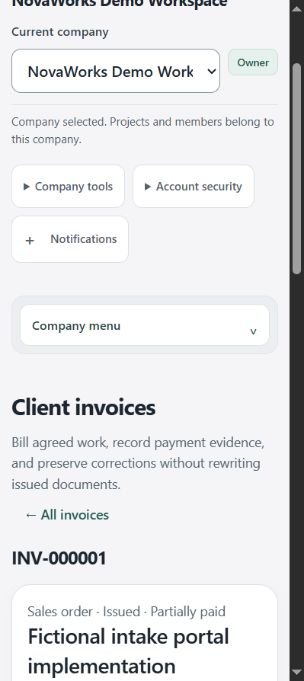

<div align="center">

# NovaWorks

### Customer relationships. Clear delivery. Connected finances.

A service-business ERP/CRM that connects customers, sales, projects, approved time and invoices in one workspace.

**[Live demo](https://nova-works-zeta.vercel.app/)** · **[Watch the full walkthrough](docs/assets/novaworks-workflow-guide-20261028.mp4)** · **[Run locally](#run-locally)**

</div>

## See the workflow

From the first conversation to the final invoice:

**Lead → Customer & deal → Quote → Sales order → Project & tasks → Approved time → Invoice → Reports**

[](docs/assets/novaworks-workflow-guide-20261028.mp4)

**[Watch the full walkthrough →](docs/assets/novaworks-workflow-guide-20261028.mp4)**

The silent, captioned walkthrough uses fictional local records. It is an edited sequence showing the fixed-price workflow; it does not demonstrate live AI generation or payment processing. [Walkthrough notes](docs/WORKFLOW_TUTORIAL.md)

## Inside the workspace

### Sales pipeline

Manage customer relationships, qualify leads and follow opportunities through the sales process.



### Invoices and payment records

Issue invoices, export PDFs and track recorded receipts and outstanding balances.



## Capabilities

| Area | Included |
| --- | --- |
| CRM & sales | Customers, contacts, activities, leads, deals, quotes and sales orders |
| Delivery | Projects, assigned tasks, deadlines, milestones, comments and notifications |
| Time & invoicing | Submitted time, independent approval, billing rates, order/time invoices, PDF export and credit history |
| Workspace & access | Company reports, currency separation, role-aware navigation, sessions, membership checks and stale-edit protection |

The original meeting-to-project workflow is also included. PostgreSQL deployments support company isolation through application permissions and row-level security.

## Try the demo

Open **[NovaWorks](https://nova-works-zeta.vercel.app/)** and use the demo entry point offered by the sign-in screen. The workspace contains shared fictional business records. Explore Overview, Customers, Pipeline, Projects & tasks, Timesheets, Invoices and Reports using sample data only.

## Run locally

Requires **Node.js 24** and **npm**. Clone the repository, then install the locked dependencies:

```sh
git clone https://github.com/Aizaz-Noor/Nova-Works.git
cd Nova-Works
npm ci
npm ci --prefix backend
npm ci --prefix app/client
npm run build:client
npm run start:demo
```

Open **http://127.0.0.1:3048/** and select **Explore demo workspace**. The local demo uses its own fictional SQLite data under `tmp/` and refuses hosted database or production configuration. Keep the terminal open while using it; press Ctrl+C to stop.

## Built with

**React 19 · Vite 6 · Node.js 24 · Express 5 · SQLite · PostgreSQL · Vercel**

## Documentation

[Developer guide](docs/README.md) · [Testing](docs/TESTING.md) · [Workflow notes](docs/WORKFLOW_TUTORIAL.md) · [Deployment](docs/deployment/README.md)

## Current scope

NovaWorks is a demonstration for service teams. Inventory, payroll, HR, purchasing, POS, general-ledger accounting and customer approval portals are outside its current scope. Payment entries record external receipts; the application does not move money. Live AI generation, recovery email, durable hosted attachments and persistent workers are not configured for the public demo.

Keep local credentials in an untracked `backend/.env` file or a hosting secret manager. Never commit database URLs, session secrets, provider keys, private certificates or database backups.
